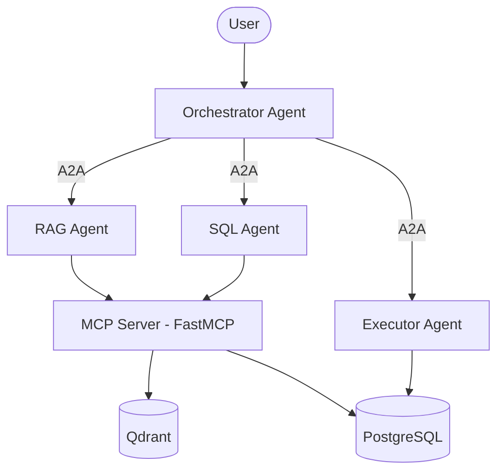

# MultiAgentAnalyst — Google ADK Prototype

> First prototype of my undergraduate thesis with **DATAX**: a multi-agent system that turns natural-language business questions into SQL over a PostgreSQL star-schema data warehouse.
>
> The final version, rebuilt with the OpenAI Agents SDK and a Neo4j knowledge graph, is in **[Analyst_DATAX](https://github.com/valdinho3752/Analyst_DATAX)**.

This prototype tested the core idea: separate agents for discovery, SQL generation, and execution. The agents are built with **Google's Agent Development Kit (ADK)**, run as independent services that talk over the **A2A protocol**, and share database tools through an **MCP server**.

---

## Architecture



| Component | Responsibility |
|---|---|
| **Orchestrator Agent** | Receives the question and delegates to the sub-agents through A2A clients |
| **RAG Agent** | Finds relevant tables with semantic search over table metadata |
| **SQL Agent** | Generates SQL from the retrieved schema and returns structured JSON |
| **Executor Agent** | Runs the generated SQL against PostgreSQL |
| **MCP Server** | FastMCP tools: `get_table_schema`, `search_relevant_tables`, `search_exact_members` |
| **Qdrant** | Vector store for table and column metadata embeddings |
| **PostgreSQL** | The data warehouse |

Each agent is exposed as an A2A service with ADK's `to_a2a()`. The orchestrator finds each sub-agent through its agent card.

---

## Tech Stack

**Agents:** Google ADK, A2A SDK, Gemini models (configurable per agent)
**Tools:** MCP (FastMCP)
**Embeddings:** Vertex AI embeddings, plus a FastEmbed alternative for local or offline ingestion
**Data:** PostgreSQL, SQLAlchemy, Qdrant
**Infrastructure:** Docker Compose

---

## Getting Started

### Prerequisites
- Docker and Docker Compose
- A Google Cloud project with Vertex AI enabled, and credentials
- A PostgreSQL backup of the data warehouse (not included)

### Configuration
Create a `.env` file with your Google Cloud project, database credentials, and the model for each agent:

```env
GOOGLE_CLOUD_PROJECT=your-project-id
GOOGLE_CLOUD_LOCATION=us-central1
LLM_MODEL_RAG=gemini-...
LLM_MODEL_SQL=gemini-...
LLM_MODEL_EXECUTOR=gemini-...
```

### Ingest metadata and run
```bash
# Embed table metadata into Qdrant (Vertex AI or FastEmbed)
python ingest_vertex.py      # or: python ingest_fastembed.py

docker compose up -d
```

---

## Project Structure

```
├── ochestrator_agent/   # Orchestrator (A2A client to sub-agents)
├── rag_agent/           # Semantic table discovery
├── sql_agent/           # SQL generation
├── executor_agent/      # SQL execution
├── mcp_server/          # FastMCP tool server
├── metadata/            # Metadata builder + DB connection
├── chunker.py           # Metadata chunking
├── ingest_vertex.py     # Vertex AI embedding ingestion
├── ingest_fastembed.py  # FastEmbed embedding ingestion
└── docker-compose.yml
```

---

## What Changed in the Final Version

Lessons from this prototype shaped [Analyst_DATAX](https://github.com/valdinho3752/Analyst_DATAX):

- Added a **Neo4j knowledge graph** that validates dimension members and their hierarchy before any SQL is generated.
- Added a **Graph Agent** and a **self-correction loop** between the executor and the SQL agent.
- Moved to the **OpenAI Agents SDK** with strictly typed outputs, and grew the metadata from 13 to 50+ tables.

## Author

**Alejandro Valdivia** — [GitHub](https://github.com/valdinho3752)
